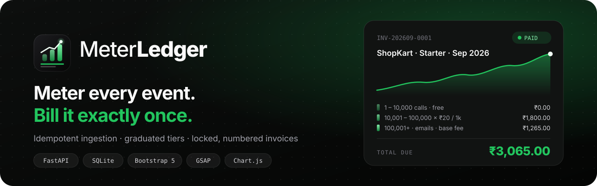
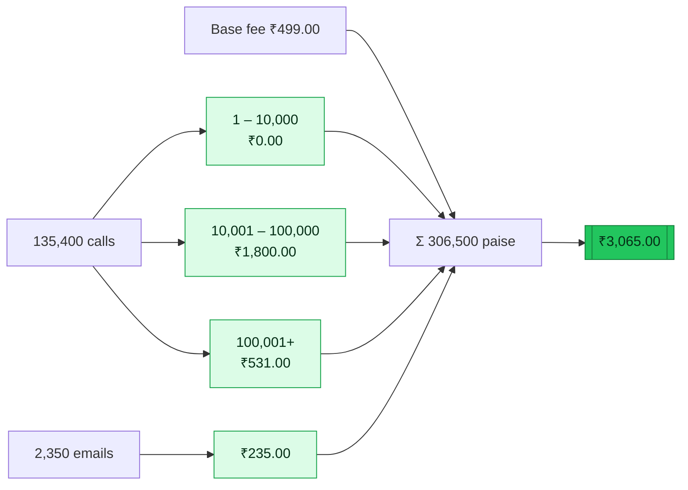
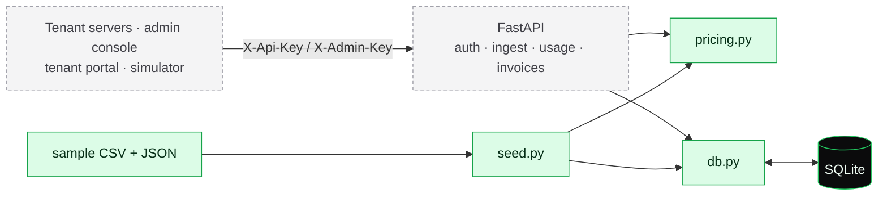

<p align="center">
  <picture>
    <source media="(prefers-color-scheme: dark)" srcset="docs/brand/logo-dark.svg">
    
  </picture>
</p>

<p align="center">
  
</p>

<p align="center">
  
  
  
  
</p>

# MeterLedger: usage-based billing and metering

**PST_AD_162 · FinTech · Usage Metering & Billing Infrastructure**

MeterLedger is the billing back office for a company that sells an API. Every time a customer (a *tenant*)
uses the product, its server sends a small JSON usage event. MeterLedger stores each event **exactly once**,
adds them up per tenant, per meter, per month, applies the tenant's **graduated tiered** plan, and produces
an invoice with one line per tier, in exact integer paise.

> For API startups who need to bill customers for what they actually use, MeterLedger turns raw usage
> events into correct tiered invoices, unlike month-end spreadsheets that double-count retries and miss
> tier boundaries.

📄 [Product requirements (PDF)](PST_AD_162_UsageBasedBilling_PRD_v1.0.docx.pdf) ·
📝 [One-page brief](docs/BRIEF.md) ·
🗺️ [Architecture & flow charts](docs/ARCHITECTURE.md) ·
✅ [Week 1 summary](docs/WEEK1_SUMMARY.md) ·
🖥️ [Frontend guide](docs/FRONTEND.md)

---

## Week 1: Pricing & data ✅

| PRD Week 1 deliverable | Where |
|---|---|
| One-page brief | [`docs/BRIEF.md`](docs/BRIEF.md) |
| Repo and README skeleton | this file, [`docs/`](docs/) |
| `pricing.py` with all six Section 15 cases as tests | [`app/pricing.py`](app/pricing.py), [`tests/test_pricing.py`](tests/test_pricing.py) |
| `schema.sql` | [`app/schema.sql`](app/schema.sql) |
| `seed.py` that loads plans, tenants and events from the CSV | [`scripts/seed.py`](scripts/seed.py), [`data/`](data/) |
| SQL query that prints monthly totals | [`scripts/monthly_totals.sql`](scripts/monthly_totals.sql) |

**Checkpoint:** six pricing tests green ✔ · seed totals printed per tenant ✔

📋 Full write-up with results, decisions and numbers: **[docs/WEEK1_SUMMARY.md](docs/WEEK1_SUMMARY.md)**

## Quick start

```bash
python3 -m venv .venv && source .venv/bin/activate
pip install -r requirements.txt
python -m pytest            # C1–C6 + tier rules + seed checks
python scripts/seed.py      # builds data/meterledger.db and prints monthly totals
```

The seed output (API keys are random each run and shown only once):

```text
Events read 2,146 · accepted 2,063 · duplicates skipped 83 · conflicts 0 · rows in usage_events 2,063

Tenant       Plan     Period    API calls   Emails  Events  Invoice estimate
----------------------------------------------------------------------------
ShopKart     starter  2026-09     135,400    2,350     106         ₹3,065.00
TinyBot      free     2026-09       8,200        0       6             ₹0.00
PayNest      growth   2026-09     521,300    8,120     388         ₹7,819.00
…            (6 tenants × 3 months)
```

The 83 skipped rows are retries planted in the CSV on purpose: a spreadsheet would bill them twice.
Query the database directly with `sqlite3 -header -column data/meterledger.db < scripts/monthly_totals.sql`.

## Frontend: the MeterLedger console (S1–S9)

All nine PRD screens are built with HTML, CSS, JavaScript modules and GSAP animations, with light and dark themes.
Until the FastAPI backend lands, they run on an in-browser **mock API** that follows the PRD Section 9 contract,
so switching to the real backend is one setting (`API_MODE` in `app/static/js/config.js`).

```bash
npm run dev               # → http://localhost:5173 (Node 18+, nothing to install)
npm run test:frontend     # PRD cases C1–C6 against the JavaScript pricing mirror
```

On the sign-in page, **Demo keys** lists the admin key and one key per demo tenant. Click a key, then **Sign in**.

| Screen | Page |
|---|---|
| S1 Sign in · S2 Overview · S3 Tenants | `index.html` · `overview.html` · `tenants.html` |
| S4 Tenant detail · S5 Plans & pricing | `tenant.html` · `plans.html` |
| S6 Invoices · S7 Invoice detail | `invoices.html` · `invoice.html` |
| S8 Event simulator (with retry storm) · S9 Tenant portal | `simulator.html` · `portal.html` |

Full screen-by-screen guide, theming and the backend hand-off: **[docs/FRONTEND.md](docs/FRONTEND.md)**

## How the money works

* All amounts are **integers in paise** (100 paise = ₹1). No floats.
* Prices are **per 1,000 units**: `price_per_1000_paise = 2000` means ₹20 per 1,000 calls.
* Tiers are **graduated**: units fill tier 1, the overflow goes to tier 2, and so on.
* **Each line is rounded on its own**, half up: `amount = (units × price_per_1000 + 500) // 1000`.

### Worked example C1: ShopKart on Starter, September 2026

| Line | Units | Rate | Working (paise) | Amount |
|---|---:|---:|---|---:|
| Base fee | | | 49,900 | ₹499.00 |
| API calls 1 to 10,000 | 10,000 | ₹0 / 1,000 | 10,000 × 0 ÷ 1,000 = 0 | ₹0.00 |
| API calls 10,001 to 100,000 | 90,000 | ₹20 / 1,000 | 90,000 × 2,000 ÷ 1,000 = 180,000 | ₹1,800.00 |
| API calls 100,001+ | 35,400 | ₹15 / 1,000 | 35,400 × 1,500 ÷ 1,000 = 53,100 | ₹531.00 |
| Emails | 2,350 | ₹100 / 1,000 | 2,350 × 10,000 ÷ 1,000 = 23,500 | ₹235.00 |
| **Total** | | | **306,500** | **₹3,065.00** |



| Case | Situation | Expected |
|---|---|---:|
| C1 | ShopKart, Starter, 135,400 calls, 2,350 emails | ₹3,065.00 |
| C2 | TinyBot, Free, 8,200 calls | ₹0.00 |
| C3 | Starter, exactly 10,000 calls (boundary) | ₹499.00 |
| C4 | Starter, 100,001 calls (boundary + rounding) | ₹2,299.02 |
| C5 | Free, 12,345 calls (rounding) | ₹58.63 |
| C6 | e-1001 sent three times + e-1002 once | ₹499.00 (800 calls, not 1,800) |

## Architecture



Green is built (Week 1); grey comes next. All nine diagrams, including the seed pipeline, ingestion and
idempotency, the retry-storm sequence, the invoice state machine and the ER diagram, are in
**[docs/ARCHITECTURE.md](docs/ARCHITECTURE.md)**.

## Data model

Seven tables in [`app/schema.sql`](app/schema.sql): `meters`, `plans`, `price_tiers`, `tenants`,
`usage_events`, `invoices`, `invoice_lines`. The key rules:

* `UNIQUE(tenant_id, event_id)` on `usage_events` is the idempotency guarantee.
* Tenants store only `api_key_hash` (SHA-256) and an 8-character `key_prefix`; the raw key is shown once.
* One live invoice per tenant per month (`UNIQUE(tenant_id, period) WHERE status <> 'void'`).
* Invoice lines are a snapshot, so later plan edits never change them.

## Repository layout

```text
app/
  pricing.py              price_tiers(), build_invoice(): pure functions, no I/O
  db.py                   sqlite3 helpers: schema, record_event (idempotent), monthly_usage
  schema.sql              PRD Section 8 data model
  static/                 frontend: one HTML page per screen, css/, js/ (GSAP motion, mock API)
data/
  sample-data.json        meters, 3 plans with tiers, 6 tenants
  cloud_api_usage_sample.csv   simulated metering export, 3 months, with planted retries
scripts/
  seed.py                 build the database and print totals per tenant
  monthly_totals.sql      the monthly totals query
  generate_sample_csv.py  regenerates the CSV deterministically
  dev-server.mjs          static server for the frontend (npm run dev)
tests/
  test_pricing.py         C1–C6 + tier rules
  test_seed.py            seed totals, retries stored once, keys hashed
frontend-tests/
  pricing.test.mjs        C1–C6 against the JavaScript pricing mirror
docs/
  BRIEF.md · ARCHITECTURE.md · FRONTEND.md · brand/
```

Coming next (PRD Section 7): `app/main.py`, `models.py`, `ingest.py`, `invoices.py`, `auth.py`,
`scripts/retry_storm.py`, `analysis/report.py`, `.env.example`.

## Roadmap

- [x] **Week 1: Pricing & data.** Brief, repo, pricing + six tests, schema, seed, totals query ([summary](docs/WEEK1_SUMMARY.md))
- [ ] **Week 2: Ingestion API.** Auth dependencies, `POST /events` and `/events/batch` with idempotency, usage / daily / estimate, tenants and plans, `retry_storm.py`
- [ ] **Week 3: Invoices & console.** Generate / finalize / pay / void, screens S1–S7, tenant portal S9
- [ ] **Week 4: Analysis & ship.** CSV export, `report.py` (3 charts), simulator S8, accessibility pass, deploy, demo video

## Brand

<p>
  
  &nbsp;
  
</p>

Three rising bars for graduated tiers, a usage line with a live reading, and ledger lines underneath.
Files: [`logo-mark.svg`](docs/brand/logo-mark.svg) · [`logo-light.svg`](docs/brand/logo-light.svg) ·
[`logo-dark.svg`](docs/brand/logo-dark.svg) · [`banner.svg`](docs/brand/banner.svg).
Colours: mint `#22c55e` · deep green `#16a34a` · ink `#0b0b0c`.

---

<sub>Assumptions (PRD Section 16): one currency (INR), no GST, billing periods are UTC calendar months, the
metering CSV is simulated, so tenant names and numbers are illustrative.</sub>
