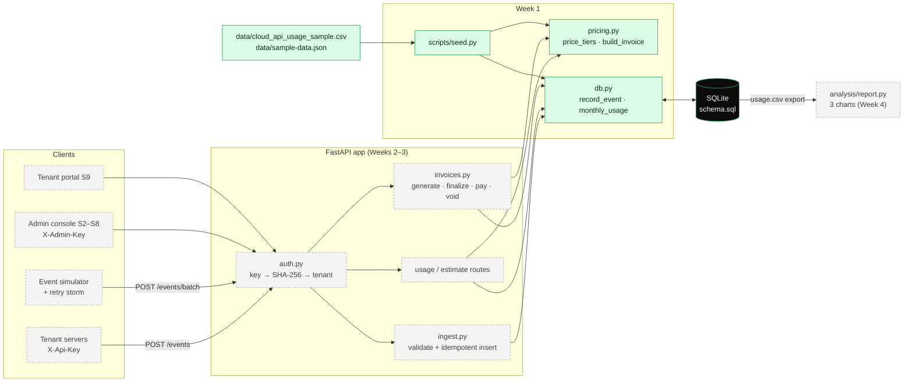
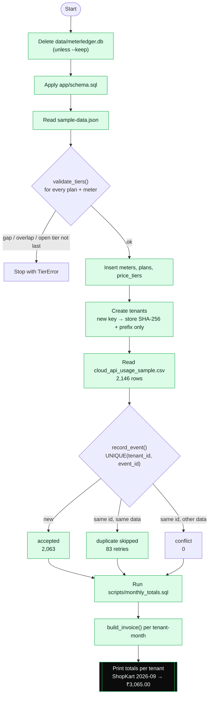
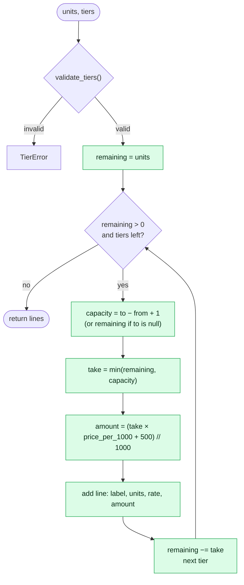
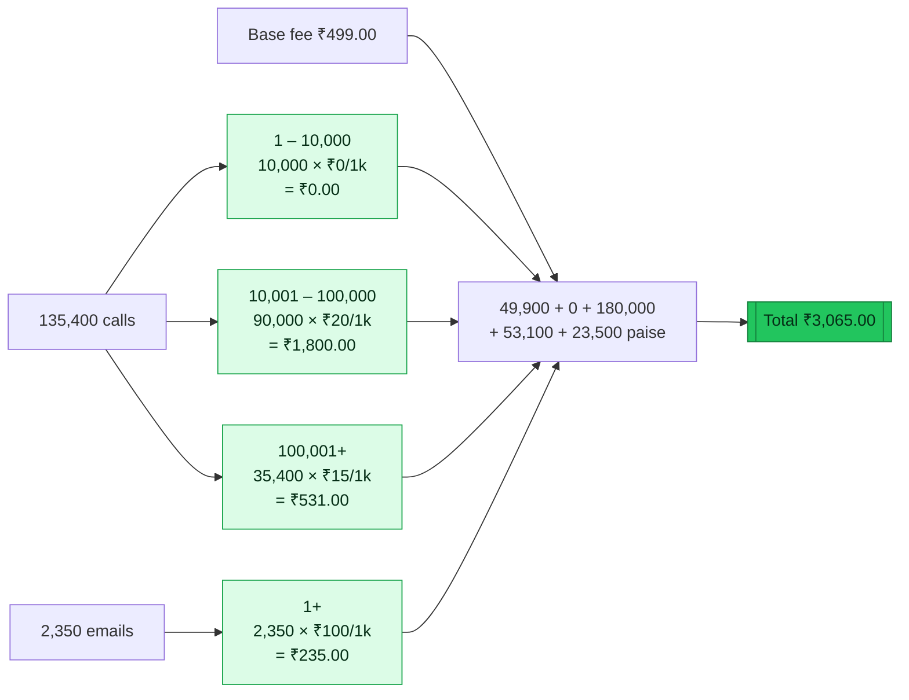
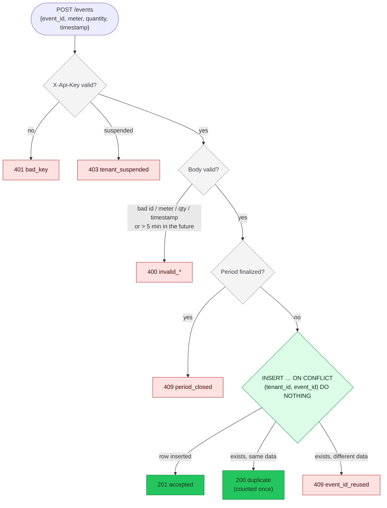
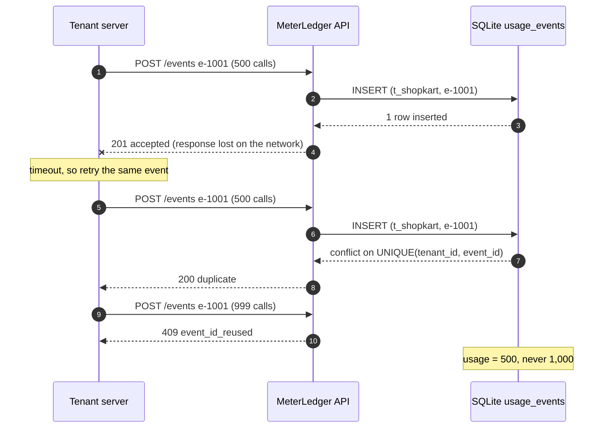
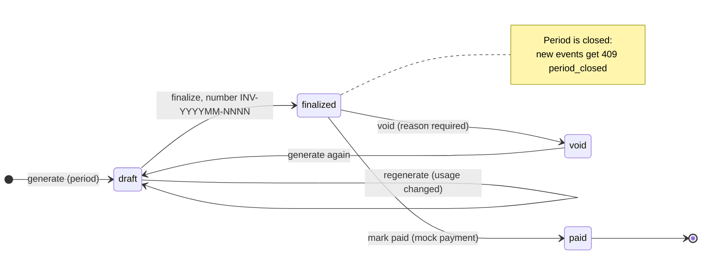
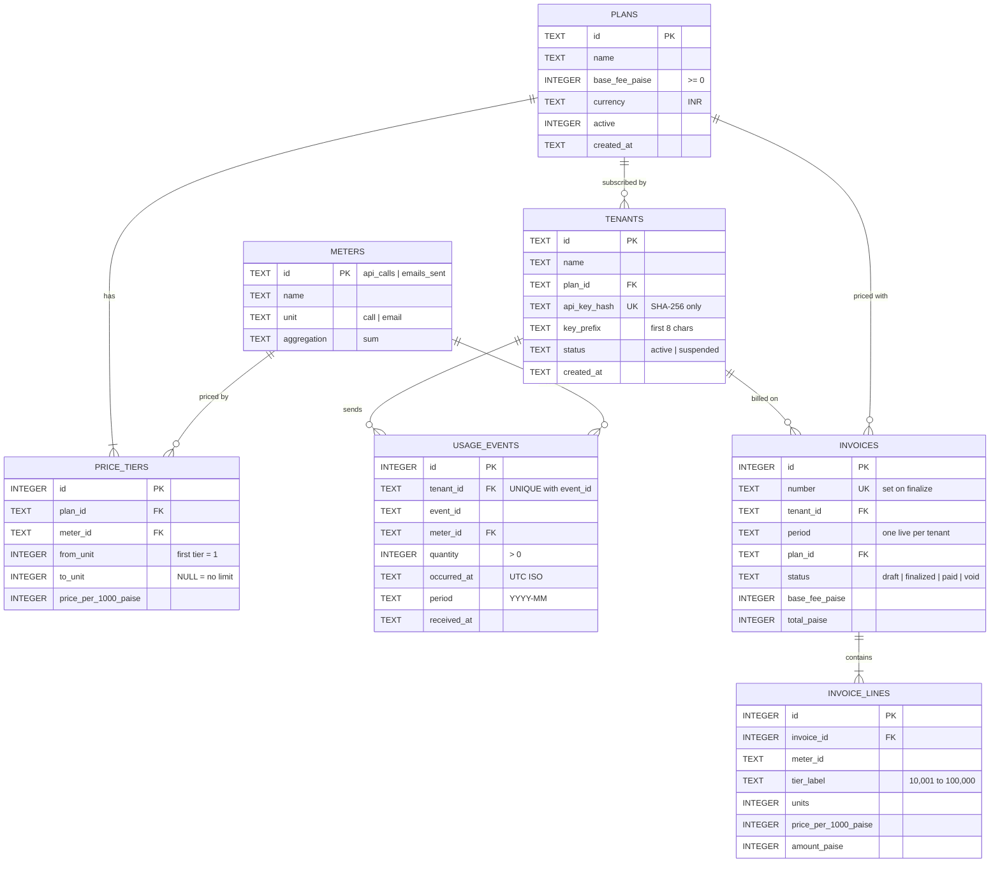
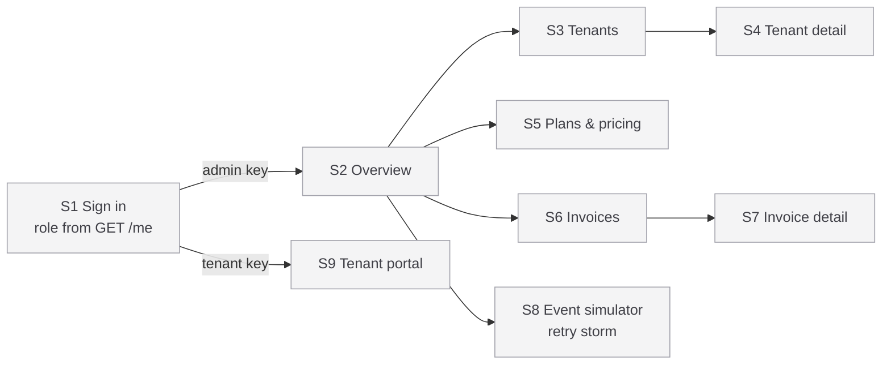

# MeterLedger architecture and flow charts

GitHub draws every diagram on this page from text (Mermaid), so they stay in step with the code.
**Week 1 parts are green**; parts built in later weeks are grey.

- [1. System overview](#1-system-overview)
- [2. Week 1 seed pipeline](#2-week-1-seed-pipeline)
- [3. Graduated pricing](#3-graduated-pricing)
- [4. Worked example C1](#4-worked-example-c1)
- [5. Event ingestion and idempotency](#5-event-ingestion-and-idempotency)
- [6. Retry storm](#6-retry-storm)
- [7. Invoice lifecycle](#7-invoice-lifecycle)
- [8. Data model](#8-data-model)
- [9. Screen map](#9-screen-map)

---

## 1. System overview

## 2. Week 1 seed pipeline

What `python scripts/seed.py` does, end to end.

## 3. Graduated pricing

`price_tiers(units, tiers)` fills tiers in order; each tier is billed at its own rate and each line is
rounded on its own.

`build_invoice(plan, usage)` runs this for every meter, then adds the base fee:
`total = base_fee + Σ line amounts`. All values are integer paise.

## 4. Worked example C1

ShopKart on Starter, September 2026: 135,400 API calls and 2,350 emails.

| Case | Situation | Expected | Test |
|---|---|---|---|
| C1 | ShopKart, Starter, 135,400 calls, 2,350 emails | ₹3,065.00 | `test_c1_shopkart_starter_worked_example` |
| C2 | TinyBot, Free, 8,200 calls | ₹0.00 | `test_c2_tinybot_free_all_in_free_tier` |
| C3 | Starter, exactly 10,000 calls | ₹499.00 | `test_c3_exact_boundary_puts_nothing_in_tier_2` |
| C4 | Starter, 100,001 calls | ₹2,299.02 | `test_c4_one_unit_over_boundary_rounds_half_up` |
| C5 | Free, 12,345 calls | ₹58.63 | `test_c5_free_plan_rounding` |
| C6 | e-1001 sent 3×, e-1002 once | ₹499.00 (800 calls, not 1,800) | `test_c6_retried_events_are_counted_once` |

## 5. Event ingestion and idempotency

`POST /events` (Week 2). Week 1 already has the core of it: `db.record_event` and the UNIQUE constraint.

## 6. Retry storm

Why a client can safely resend: the database, not the client, decides what is new.

`scripts/retry_storm.py --seed 7` (Week 2): 20,000 unique events × 1–9 sends, about 100,000 requests from
4 threads. Pass when `accepted = 20,000` and `/usage` totals equal the sum of unique events.

## 7. Invoice lifecycle

Refused moves return `409 invalid_transition`, for example paying a draft or voiding a paid invoice.

## 8. Data model

## 9. Screen map

The web screens from PRD Section 10 (Weeks 3–4).

